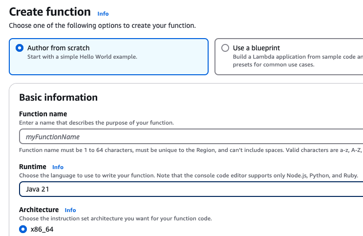
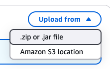
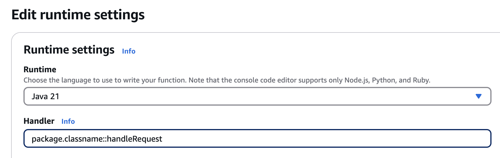

### AWS Lambda

AWS documentation:

* [Building Lambda functions with Java](https://docs.aws.amazon.com/lambda/latest/dg/lambda-java.html)
* [Define a Lambda function handler in Java](https://docs.aws.amazon.com/lambda/latest/dg/java-handler.html)
* [Deploy Java Lambda functions with .zip or JAR file archives](https://docs.aws.amazon.com/lambda/latest/dg/java-package.html)
* [Creating and managing Lambda function URLs](https://docs.aws.amazon.com/lambda/latest/dg/urls-configuration.html)
* [Invoking Lambda function URLs](https://docs.aws.amazon.com/lambda/latest/dg/urls-invocation.html)

``` groovy 

    implementation 'com.amazonaws:aws-lambda-java-core:1.4.1'
    implementation 'com.amazonaws:aws-lambda-java-events:3.16.1'
    
    // this is to turn JSON into Java objects
    implementation 'com.google.code.gson:gson:2.15.0'

```

`YourRequest` and `YourResponse` are the classes that you create that get sent as and returned as JSON.
See the [Java handler documentation](https://docs.aws.amazon.com/lambda/latest/dg/java-handler.html) for more details.

``` java 
public class HelloRequestHandler implements RequestHandler<APIGatewayV2HTTPEvent, APIGatewayV2HTTPResponse> {

    private final Gson gson = new Gson();

    @Override
    public APIGatewayV2HTTPResponse handleRequest(APIGatewayV2HTTPEvent event, Context context) {
        try {
            // retrieve the body and change json into an object
            String method = event.getRequestContext().getHttp().getMethod();
            String body = event.getBody();
            YourRequest request = gson.fromJson(body, YourRequest.class);

            // do something with the request and create a YourResponse

            // create the HTTP response with the YourResponse
            String responseJson = gson.toJson(response);
            APIGatewayV2HTTPResponse apiResponse = new APIGatewayV2HTTPResponse();
            apiResponse.setStatusCode(200);
            apiResponse.setBody(responseJson);
            return apiResponse;
        }
        catch (Exception e) {
            // this prints the stack trace to the AWS log file
            e.printStackTrace();

            // this outputs the stack trace to the client
            return toResponseEvent(e);
        }
    }
}
```

If an `Exception` occurs in your code you can send the stack trace to the client for debugging purposes.

``` java 

    private APIGatewayV2HTTPResponse toResponseEvent(Exception e) {
        APIGatewayV2HTTPResponse apiResponse = new APIGatewayV2HTTPResponse();
        apiResponse.setStatusCode(500);
        StringWriter stringWriter = new StringWriter();
        PrintWriter printWriter = new PrintWriter(stringWriter);
        e.printStackTrace(printWriter);
        apiResponse.setBody(stringWriter.toString());
        return apiResponse;
    }

```

## Checkstyles and JSON Variables

If a variable contains underscores which will fail checkstyles, you can disable checkstyles by wrapping the code in
comments.

``` java 
    //CHECKSTYLE:OFF
    public String station_id;
    //CHECKSTYLE:ON
```

## Uploading to AWS Lambda

You need to create a jar file of your code that has all the dependencies in it. This is known as a "fat jar".
See [Deploy Java Lambda functions with .zip or JAR file archives](https://docs.aws.amazon.com/lambda/latest/dg/java-package.html).

Add this to the `plugins` block in `build.gradle`.

``` groovy
  id 'com.gradleup.shadow' version '8.3.11'
```

Then you can run the `shadowJar` gradle task **in the Terminal** and create a jar file that has the code and
dependencies.

``` bash 
./gradlew shadowJar
```

This will create a jar file in `build/libs/`

## Creating the Lambda on AWS



Create a Lambda. Give it a Function Name and set the Runtime to Java 21



In the `Code` tab, click the "Upload from" button and find the jar file you created.

In the `Code` tab, click on the "Edit" button under "Runtime Settings". Change the Handler to point to your Lambda
classname. It should be the full package and name of your class.



In the `Configuration` tab, create a [`Function URL`](https://docs.aws.amazon.com/lambda/latest/dg/urls-configuration.html) and make sure you set the Auth Type to NONE.

## Testing your Lambda on AWS

You can test your lambda after uploading it by running the following command where `request.json` is a file containing
the json you want to send and `urlToYourLambda` is the [function url](https://docs.aws.amazon.com/lambda/latest/dg/urls-invocation.html) created by AWS to your lambda.

``` bash 

curl -X POST \
     -v \
     -H "Content-Type: application/json" \
     -d @request.json \
     urlToYourLambda

```
